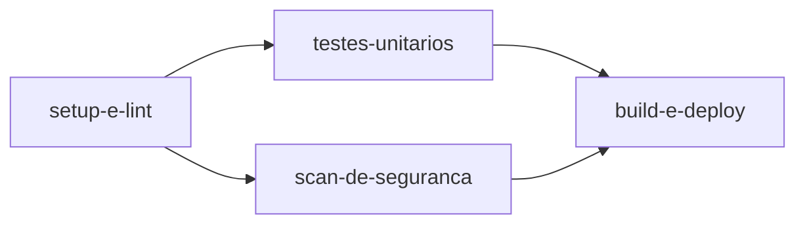

# GitHub Actions — dependências entre jobs

**Laboratório educacional de CI.** Exercício sobre ordem de execução e paralelismo em pipelines.

[Portfólio](https://github.com/Enzo-Zapparolli)

## Workflows

| Arquivo | Objetivo |
| --- | --- |
| [01-hello-local.yml](.github/workflows/01-hello-local.yml) | Imprime mensagens e a versão do Node no runner; aceita push e execução manual. |
| [02-pipeline-principal.yml](.github/workflows/02-pipeline-principal.yml) | Demonstra jobs encadeados com `needs`, acionados por push. |

## Ordem do pipeline principal

Os passos do pipeline principal executam comandos `echo`. Os nomes ilustram etapas de CI/CD, mas não realizam lint, testes, varredura de segurança ou deploy de verdade.

## Consultar

Abra a aba **Actions** para verificar execuções. O arquivo [comandos.txt](comandos.txt) e a [documentação anterior](docs/README-anterior.md) preservam os registros da atividade e os experimentos com `act`.
